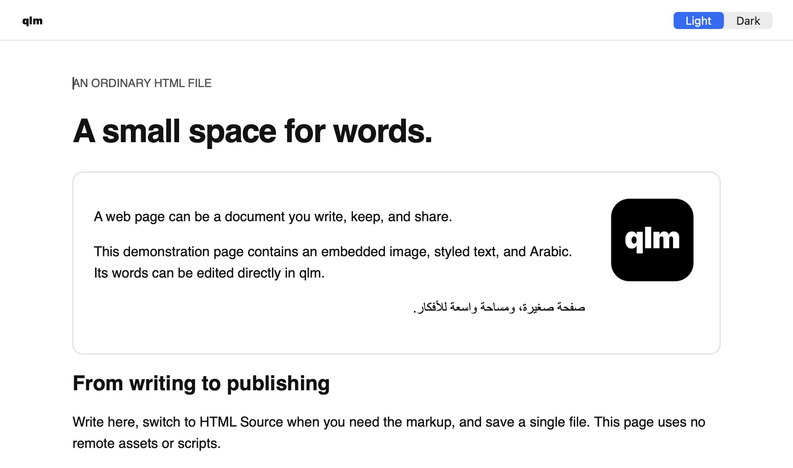

# qlm

A small space for words. A native macOS editor for writing, plain text, and pages you can edit directly.

**[Download qlm 0.4](https://github.com/FL2744/qlm/releases/tag/v0.4)** · macOS 15+ · Apple silicon and Intel

Technical paper: [PDF](paper/qlm.pdf) · [LaTeX](paper/qlm.tex) · [Markdown](paper/qlm.md) · [Source bundle](paper/Source.zip)

qlm starts with an ordinary text document. Add a picture and it becomes a self-contained HTML file. Open an HTML page to edit its rendered text, then switch to source when you want the markup. There is no project setup, account requirement, or website build system.



## Install

Download `qlm-v0.4-macOS-universal.zip` from [Releases](https://github.com/FL2744/qlm/releases/latest), unzip it, and drag `qlm.app` to Applications. The release is Developer ID signed, notarized by Apple, and stapled. Both architectures are included in one app. Optional checksums are provided with the release.

The app requires **macOS 15 or later**. It has been exercised on the development Mac's macOS 26; macOS 15 and Intel hardware have not been runtime-tested. There is no automatic updater or update notification system.

## Write

- New documents use **Helvetica, 12 pt**, with a white workspace. Dark mode uses a black workspace and white default text; explicitly chosen colors remain visible.
- The initial window approximates 120 characters by 40 lines, within the screen. Helvetica is proportional, so this is a sizing guide.
- Open/save **TXT, MD, RTF, TEX, JSON, HTML, DOCX, PY, and JS**. Markdown and code formats are edited as source, without syntax highlighting or execution.
- Autocomplete, spelling/grammar checks, autocorrect, smart dashes, smart links, and rulers are off. Smart quotes are on in ordinary native editing and off in HTML Source. Review quote characters before using code files.
- **Format → Font…** changes selected text or the font for subsequent typing. Choose a Family and its installed Style, including Inter ExtraBold and Black. Size, bold, italic, underline, and text color are available; Apply works like Return.
- TXT and source formats save text only: their font/color choices are temporary display formatting. HTML, RTF, and DOCX can retain formatting.
- **Format → Options** contains automatic, right-to-left, and left-to-right writing direction. Arabic and mixed-direction text use the native macOS text system.
- The black title strip shows the current document type in lowercase gray text at the upper right.
- Matching side margins stay fixed while resizing or zooming. **View → Wrap to Page** optionally caps the writing width; otherwise it follows the window.
- **⌘+ / ⌘− / ⌘0** zoom in, zoom out, and reset. Mouse wheel zoom can be disabled in View; Option-wheel scrolls. Trackpad scrolling and pinch zoom are supported.
- Open Recent retains the latest 30 files. Standard save, undo, revert, find, and unsaved-document handling use AppKit's document architecture. Saves are explicit.

Files larger than **32 MiB (33,554,432 bytes)** are rejected before opening. qlm is not a streaming editor for huge datasets; long lines, dense HTML, large images, and complex imported documents can still be expensive below that limit.

## Work with HTML

Pasting HTML source into a TXT document automatically creates an HTML draft and displays the rendered page. Use **View → HTML Source** to edit the markup. Existing text is preserved, and an existing TXT file is left on disk. Ordinary copied prose and explicitly chosen code formats remain unchanged.

**Format → Options → Pretty-print Source…** opens a read-only, offline formatted preview of HTML (including embedded JS/CSS), JavaScript, or JSON. The original source stays unchanged. Previews support up to 2 MB and use bundled Prettier; no Node installation or API key is needed.

**Insert → Image…**, image paste, and image drag-and-drop create a formatted HTML draft, leaving the original file on disk. Images are embedded as PNG data URLs. qlm-generated HTML reopens as native attributed text with inline pictures. Other HTML opens in an editable WebKit rendering. Browser editing can normalize HTML, and script-driven layouts are not guaranteed to round-trip unchanged; keep an original copy of complex pages.

**View → HTML Source** switches between markup and the document. Embedded image bytes are normally shown as descriptive comments and reversible shorthand references, then restored on save. **Format → Options → Don't Hide Image Bytes in HTML** reveals the complete data URLs and remembers your choice.

Nonstandard installed TrueType/OpenType font files are embedded when supported and permitted by their embedding flags. Common system fonts use browser fallbacks. External stylesheets, CSS font shorthand, and dynamically generated font declarations are not scanned; font collections and restricted fonts may produce a save error. Font embedding does not install a font on the reader's computer. Ensure your font license permits web embedding.

Saved HTML uses the filename without `.html` as its browser title and an embedded transparent pen favicon derived from the local Wingdings 2 font. Dark-mode HTML saves default to black backgrounds and white text; disable this under **Format → Options → Save HTML in Dark Mode**.

**Insert → HTML Embed…** accepts embed code such as a YouTube iframe. Third-party embeds need the network and follow the provider's policies. Some video players fail when HTML is opened with `file://`; serve the page over HTTP(S) when needed. HTML pages and embeds can execute scripts and load remote resources. Local document storage does not make arbitrary imported HTML offline or inert.

The Font dialog and rewrite/translation actions currently operate in the native text view, not selections inside a full-page WebKit rendering. Use HTML Source to change styling in an arbitrary HTML page.

## Rewrite and translate

Configure an HTTPS endpoint, API format, model, key, and rewrite instructions in **qlm → Settings**. Save API Setup remembers them. **Stream responses** is enabled by default for new setups; saved opt-outs remain respected. It receives generated text incrementally but inserts only the completed result. Requests allow 10 minutes without incoming data and up to one hour overall; model token limits still apply.

- **⌘R** rewrites the selected passage using your saved instructions.
- **⌘T** offers 24 alphabetized target languages plus Other. Translations contain no language headings.
- Both actions keep the original and insert results beneath it, separated by a blank line. One undo removes the insertion.
- You can keep writing during a request. If the document changes, qlm offers the returned text for copying rather than inserting into a stale location. Edit → Cancel API Request cancels the request.

Presets are OpenAI Responses (`gpt-6-luna`) and Virginia Tech ARC Chat Completions (`DeepSeek-V4.1-Flash`). The endpoint and model remain editable; model availability and billing depend on your provider and account. Compatible custom Chat Completions endpoints are supported.

The app stores API configuration and endpoint-specific keys in **`~/.qlm-api.json`**, with permissions `0600`. This is a plaintext file readable by your account, not encrypted storage. qlm does not use Keychain for API keys. Keep the file out of version control and shared backups. Leave the key field blank to retain a saved key, or remove the saved key in Settings.

Requests are explicit and send selected text and instructions. The client uses an ephemeral session, refuses redirects, and sets `store: false` for Responses requests. Provider retention policies still apply. There is no app telemetry or background model request.

Select text and use **Insert → Link… (⌘H)** to add or edit a hyperlink. Plain-text/code documents become HTML drafts so links are retained, RTF/DOCX retain their format, and Markdown uses standard link syntax. Rendered HTML supports links directly; HTML Source view inserts an anchor. **Hide qlm** uses **⌃⌘H**.

Click an image and choose **Format → Resize Image…** to set its width and height. **Keep proportions** is on by default. Native and rendered HTML images retain their embedded data and saved dimensions; resizing supports Undo.

## Printing

**File → Print… (⌘P)** prepares a temporary PDF with US Letter (8.5 × 11 inch) pages, then opens the standard macOS print dialog. Native text wraps to the printable page regardless of editor zoom or window width; rendered HTML uses WebKit pagination, and TEX documents use Tectonic. HTML Source view prints the visible source. Printing does not change or save the document. The dialog supports printer selection, page ranges, copies, and Save as PDF. Add printers in macOS System Settings; available USB, network, and supported Bluetooth printers are handled by macOS and their drivers.

## Export

- **PDF:** native text/attributed documents print as paginated, white-background US Letter pages. Markdown prints as source. The full-page HTML editing surface does not have a dedicated rendered-PDF export path in 0.4; its native export can contain source rather than the rendered page.
- **LaTeX PDF:** PDF export from a TEX document invokes a local **Tectonic** installation with shell escape disabled. Install it separately with `brew install tectonic`. A complete LaTeX document is required. Relative inputs resolve from its saved folder. Missing packages may require a network download. Compiler errors preserve an existing output PDF and appear in a compact dialog with a scrollable, copyable compiler log. Keep relative images and other dependencies alongside the saved TEX file; for the technical report, extract the complete [source bundle](paper/Source.zip) before compiling.
- **PNG / JPG / TIFF:** captures the visible native app window, including the header; offscreen text is excluded. WebKit compositing and interactive embeds may not appear completely in native window captures.

RTF/DOCX import and export use Apple's attributed-text converters; qlm is not a complete Word layout engine. Complex tables, tracked changes, headers, and footnotes may lose structure.

## Build and test

Install Xcode command-line tools and Python 3, then:

```sh
./build.sh
QLM_TEST_OUTPUT="$PWD/build" ./build/qlm.app/Contents/MacOS/qlm --self-test
```

The build produces a universal app targeting macOS 15. Ordinary builds are ad hoc signed. Icon generation uses the locally installed San Francisco system font and Xcode 26 or later’s asset compiler for the layered macOS icon; favicon generation requires Wingdings 2 with its `penballpoint` glyph. Font binaries are not distributed in this repository. There are no Swift package dependencies. The offline source preview bundles Prettier 3.10.1 (MIT); its files, license, and upstream archive checksum are in `Vendor/Prettier/`. Tectonic must be installed to run the complete PDF/LaTeX test suite.

Tests cover Unicode/encoding and nine-format round-trips; defaults, margins and zoom; selected font faces and colors; large JSON preservation and size rejection; native PDF and image export; LaTeX compilation and failure handling; HTML image/font preservation, shorthand switching, editable rendering and source round-trips; offline HTML/JS/JSON pretty-printing; automatic rendered HTML paste and source toggling; format indicators; and API payloads, streaming completion/truncation, parsers, cancellation-related controls, and undo without paid calls. These checks are regression evidence, not guarantees for every HTML page or Word document.

For your own signed distribution:

```sh
SIGNING_IDENTITY='Developer ID Application: Your Name (TEAMID)' \
NOTARY_PROFILE='your-notarytool-profile' ./scripts/release.sh
```

The script builds, tests, signs with hardened runtime and a timestamp, submits to Apple, staples the accepted ticket, checks Gatekeeper, and produces a release ZIP and SHA-256 checksum. Your signing credentials stay outside the repository.

## Project files

`Sources/` contains the application and regression checks; `tools/` builds the bundle and icons; `scripts/` contains the release workflow; `examples/` contains synthetic sample documents; `paper/` contains the technical report and its figures. Build products, private drafts, API settings, and signing credentials are excluded.

## License

[MIT](LICENSE). Platform fonts and third-party services retain their own licenses and terms.

William Taggart · Modern and Classical Languages and Literatures, Virginia Tech
