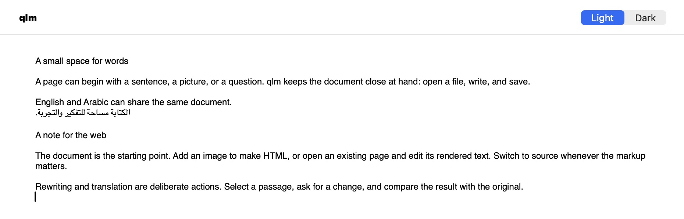
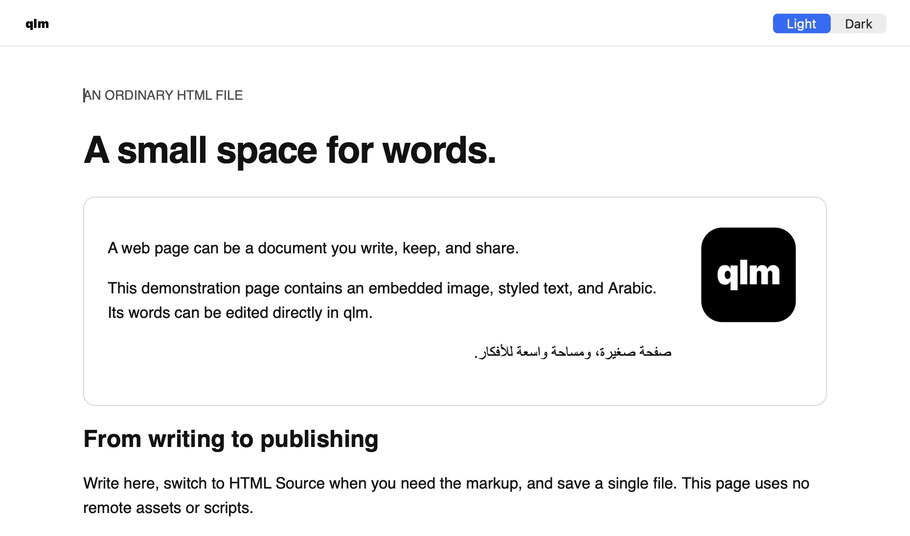
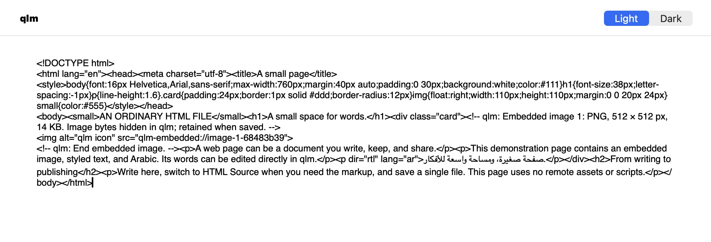
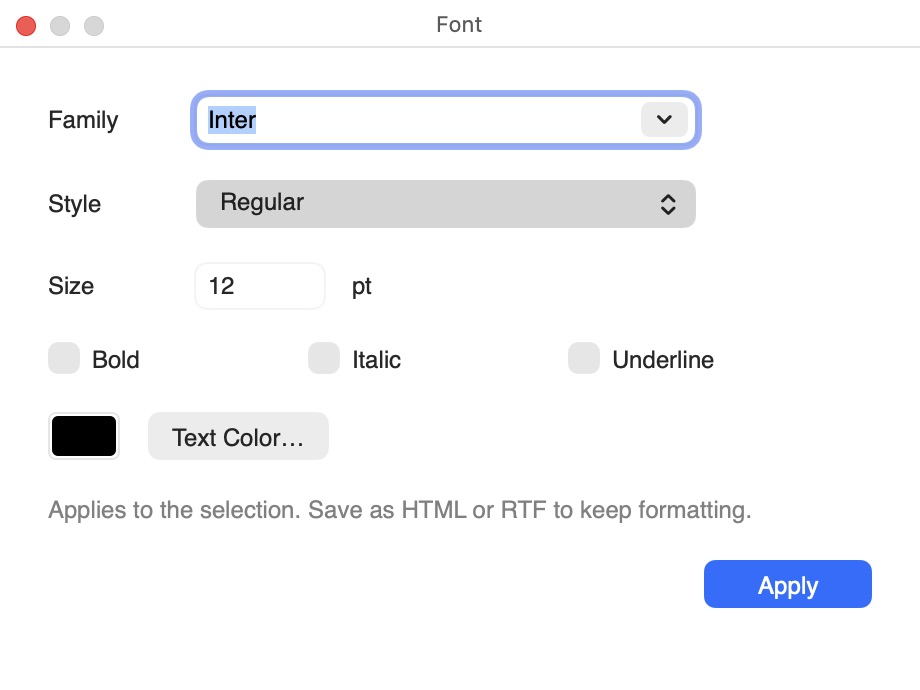
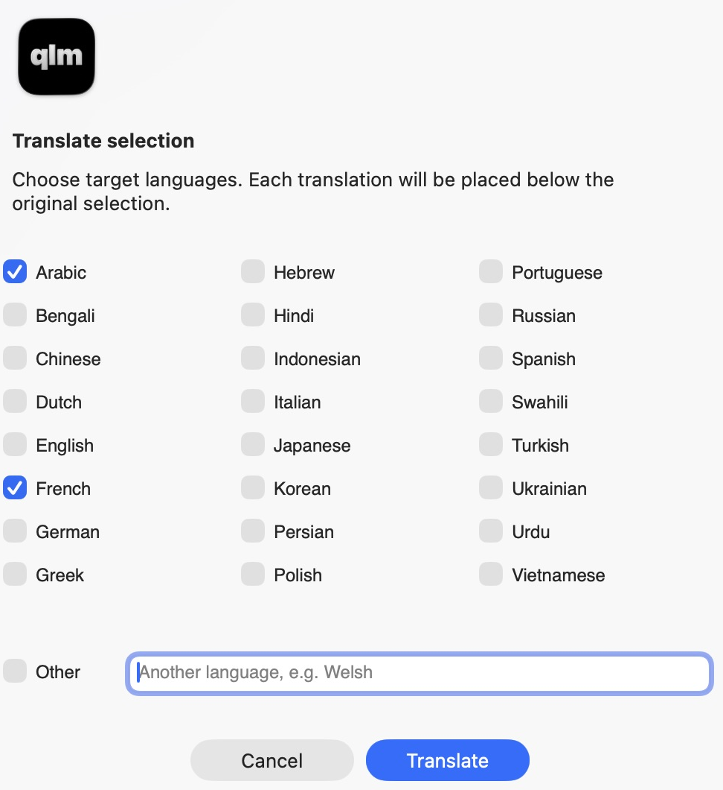

# qlm: A Native Document Editor for Writing and Small Web Pages

**William Taggart**  
Modern and Classical Languages and Literatures, Virginia Tech  
wtaggart@vt.edu

Version 0.1 · November 17, 2026

## Abstract

qlm is a native macOS editor that treats plain writing and small web pages as related document activities. It opens directly into a text workspace, supports native attributed documents, and combines editable rendered HTML with a source view whose embedded image data can be abbreviated without changing the saved file. Nonstandard fonts can be embedded for portable HTML display. Optional rewrite and translation commands act on an explicit selection and insert alternatives below the original. This report describes the 0.1 implementation, its AppKit and WebKit editing paths, serialization and persistence mechanisms, failure handling, and release checks. The design emphasizes local files, a small visible interface, and deliberate access to remote language models. Regression tests and synthetic demonstrations establish specific implementation behaviors; they do not establish usability, translation quality, arbitrary web-page fidelity, or performance for large datasets.

## Purpose and Research Context

Writing and publishing a small page should not require adopting a software project. qlm is intended for people who move between prose, notes, multilingual passages, and modest HTML pages: teachers, researchers, writers, and maintainers of personal or departmental sites. A new document begins as plain text. Formatting, pictures, source inspection, and optional language-model assistance are available when needed. The name is a compact transliteration of qalam, Arabic for pen; its lowercase wordmark reflects the intended scale of the tool.

Engelbart's account of intellectual augmentation places tools within a larger practice of thinking and working [1]. qlm adopts a narrow version of that ambition: reduce the distance between composing words and maintaining the file that contains them. Shneiderman's description of direct manipulation emphasizes visible objects, incremental action, and reversibility [2]. These ideas motivate the document-centered interface and undoable insertion of generated alternatives. They provide design context rather than evidence that this particular editor improves writing.

The first WorldWideWeb client combined browsing with editing, as Berners-Lee's historical account explains [3]. qlm revisits the practical connection between a document and a web page while retaining explicit source access. It does not claim to reconstruct that earlier browser or replace current web application development. Research on end-user software engineering shows that people creating computational artifacts outside professional programming still encounter design, debugging, and maintenance problems [4]. A visual editor reduces some syntax exposure, but cannot remove the responsibility to inspect layout, assets, and behavior.

Local-first research argues for ownership, offline access, and durable user control while also considering collaboration [5]. qlm implements local document storage and network-independent ordinary writing; it does not implement conflict-free replication, multi-user editing, or device synchronization. Its files can be kept, copied, and published independently of an account. HTML embeds and optional model requests remain network operations. This boundary matters because a local HTML file may still reference a remote video, stylesheet, or script.

CoAuthor studies how writers request, accept, dismiss, and edit model suggestions [6]. Wordcraft explores several explicitly invoked writing tasks, including rewriting and custom requests [7]. Those systems establish interaction design as a substantive part of assisted writing. qlm uses a smaller interaction: select a passage, request a rewrite or translation, and receive a new passage beneath the original. It has no model training pipeline, automatic continuation, or quality estimator. Preserving the source makes comparison possible, but the value of that comparison has not been evaluated in a controlled study.

## The Writing Surface

Figure 1 shows the native writing workspace with synthetic English and Arabic text. The header contains only the lowercase wordmark and Light/Dark controls. A black native title strip remains available for dragging the window. New text uses 12-point Helvetica, and the initial window approximates a 120-character by 40-line workspace within the available screen. Because Helvetica is proportional, these dimensions describe a sizing target rather than a character-cell grid.

**Figure 1.** The native writing surface with synthetic English and Arabic passages. The compact header leaves document text as the primary visible object.

The native editor disables continuous spelling and grammar checking, correction, completion, automatic dashes, link detection, text replacements, and rulers. Smart quotes remain enabled for ordinary native editing and are disabled in HTML Source. Code and Markdown are source text rather than rendered or executable documents; consequently, smart quotes in a code file require attention. The application supplies find, standard document saving, unsaved-change prompts, undo, and a recent-file list capped at 30 entries.

Zoom changes viewing magnification without modifying saved font sizes. Keyboard shortcuts provide zoom in, zoom out, and reset; the scroll wheel can zoom unless the user disables that behavior or holds Option to scroll. Precise trackpad scrolling normally remains scrolling, with modified scrolling and pinch available for zoom. The text container follows the window width, while an optional Wrap to Page setting caps it at the nominal page width. The implementation rescales text insets to retain matching 48-point screen margins on the sides and a 28-point top inset.

Light mode uses a white background. Dark mode uses black with default text displayed in white through layout-manager temporary attributes. Explicit nonblack text colors remain visible, and the display mapping does not rewrite the underlying document colors. Font changes operate on the selected character range, or on typing attributes if the range is empty. For plain text, that styling is transient: the file contains characters and line endings, not font metadata.

## Architecture and Document Representations

The application is written in Swift with AppKit for document windows and text editing, SwiftUI for API settings, and WebKit for rendered HTML. Its source has no external Swift package dependencies. The build compiles arm64 and x86_64 executables targeting macOS 15, combines them into a universal binary, generates icon resources, and constructs a standard application bundle. A command-line self-test mode exercises the same implementation used by the GUI; it is a verification surface, not a separate editor product.

Apple's NSDocument architecture separates persistent document data from its windows and controller objects [8]. qlm follows that division: QLMDocument reads and serializes content, EditorController manages views and editing state, and QLMDocumentController maps file extensions and recent documents. An attributed string holds native text and attachments. PlainCodec preserves UTF-8 or BOM-marked UTF-16 encodings and remembers a UTF-8 BOM when present. Unsupported byte encodings produce a conversion error. Saving is explicit; the document class does not enable autosaves in place.

There are three important editing states. Plain and imported attributed documents use NSTextView. qlm-generated HTML with its own marker is decoded into native attributed text and image/embed attachments. Arbitrary HTML instead retains a source string and opens in an editable WKWebView. HTML Source temporarily exposes markup in the native text view. A source switch is therefore a representation change, not merely hiding one pane. Table 1 identifies what is retained and where fidelity limits arise.

| Input or state | Working representation | Persistence boundary |
| --- | --- | --- |
| TXT, MD, TEX, JSON, PY, JS | Native text with display attributes | Characters and encoding; no saved styling |
| RTF and DOCX | Native attributed text | Apple attributed-text converters |
| qlm-generated HTML | Attributed text and attachments | qlm HTML serializer and metadata |
| Other HTML | Source plus editable WebKit DOM | Serialized DOM after a rendered edit |
| HTML Source | Native text plus optional image projection | Expand shorthand before rendering or saving |

**Table 1.** Editing states and their persistence boundaries.

Arabic and mixed-direction passages rely on native macOS shaping and paragraph direction controls. The Unicode Bidirectional Algorithm distinguishes logical storage order from visual ordering [9]. qlm does not implement its own bidirectional algorithm or claim exhaustive Unicode conformance testing. Automatic, right-to-left, and left-to-right choices are exposed under Format Options. Tests include mixed Unicode text and Arabic round-trips, while screenshots demonstrate representative rendering rather than comprehensive script coverage.

## HTML as an Editable Document

Figure 2 shows an ordinary HTML sample with styles, an embedded image, and Arabic. A user can edit text in its rendered body without first removing its visual structure. The mechanism uses the HTML contenteditable facility described by the HTML Standard [10]. Editing makes the current document object model the source of subsequent serialization. Consequently, browser repairs, normalized attributes, script-driven mutations, or altered whitespace may differ from the original source. qlm is not a lossless visual editor for every website or a round-trip compiler for arbitrary web applications.

**Figure 2.** An ordinary HTML document rendered in the editable WebKit surface. The synthetic page includes an embedded qlm icon, CSS styling, and Arabic text.

### Synchronizing rendered edits

A main-frame script in an isolated WebKit content world enables editing on the body and disables spelling, correction, completion, and capitalization aids there. It records the original values of those attributes. On input, an immediate message marks the document changed; a debounced message, after approximately 180 ms of inactivity, supplies serialized HTML. A per-render generation identifier rejects stale callbacks, and the native bridge requires messages to originate in the main frame.

Serialization clones the document root, restores the original body attributes in that clone, and includes document-level doctype and comment nodes. This prevents editor-only contenteditable settings from being written into the saved page. Before saving or entering Source view, the controller explicitly requests the latest serialization, with a bounded wait of five seconds. A busy or failed synchronization produces an error rather than silently claiming a successful save. Untouched previews retain their source string without an unnecessary normalization pass.

For qlm-generated rich HTML, entering Source view retains an attributed snapshot and the native undo manager. Returning without a source edit restores that snapshot. Editing the markup moves the document to the general HTML path, where WebKit becomes the rendered editing surface. This distinction was important during development: a previous transition exposed a read-only preview after source editing. Regression checks now edit the rendered body, save immediately, and verify both typed text and existing embeds. They also exercise a return to Source view and preservation of comments before the doctype.

### Images, fonts, and source projection

Inserting, pasting, or dropping a picture creates an HTML draft and detaches the destination from the original file path. Images are converted to PNG data URLs, scaled for display, and retained inside the saved HTML. This avoids a companion image folder. Its cost is file size: base64 expands n binary bytes to 4 times the ceiling of n divided by 3 characters, before markup overhead. A single-file document can therefore be portable while still being expensive to load and inspect.

Figure 3 illustrates a reversible source projection. The editor replaces recognized base64 image data URLs with document-local tokens, surrounds relevant markup with comments identifying format, dimensions, and byte size, and retains a token-to-original mapping. Expansion removes those generated comments and restores the original data before save or rendering. An unrecognized shorthand token blocks saving with an actionable error. The projection affects image data, including image favicons, but does not abbreviate every possible binary or font payload.

**Figure 3.** HTML Source with the embedded image represented by a descriptive comment and a reversible shorthand URL. Saved HTML contains the complete data URL.

The View Options command, Don't Hide Image Bytes in HTML, reverses that display choice immediately and persists the preference. Switching the representation preserves the expanded source and whether a rich snapshot is still unchanged. The implementation clears the source view's undo history during that visibility conversion so prior replacement offsets and shorthand mappings cannot be reused incorrectly. This is a concrete tradeoff between reversible file serialization and preserving every intermediate source-view edit operation.

For portable typography, the HTML serializer inspects installed TrueType/OpenType font files and their embedding permission flags. Nonstandard supported faces can be included as data URLs with CSS font-face declarations. Standard families and macOS system fonts use fallbacks. Exact font identities are retained in qlm metadata for reopening when installed; embedded web fonts are not installed into the operating system. Missing files, restricted flags, and unsupported font containers can cause a save error. Font license terms remain separate from the permission bits. Source scanning covers explicit font-family declarations in style blocks and inline styles, not external stylesheets, shorthand properties, or dynamically produced CSS.

Saved pages receive a filename-derived browser title and an embedded transparent pen favicon generated from the locally available Wingdings 2 glyph. A dark HTML saving option adds owned appearance CSS for black backgrounds and white text, while keeping author styles beneath it for later restoration. This exported appearance is a separate mechanism from temporary native dark-mode text attributes. Embedded iframe code is retained alongside a rendered wrapper; third-party playback still depends on network access and origin/referrer requirements. A file opened through file:// may behave differently from a page served over HTTP(S).

## Typography and Deliberate Language Assistance

Figure 4 shows the Font panel. A family selector is paired with a Style menu populated from installed font-family members, rather than reducing all choices to regular and bold. Exact PostScript face names are used when applying a face, and size changes preserve that face. Bold and italic controls convert traits from the selected face; underline and color apply attributes to the selected range. Formatting registers an undo operation. The panel is available for the native editing surface; it does not currently style a selected range inside a full-page WebKit document.

**Figure 4.** The Font panel exposes font family, installed style, point size, traits, underline, text color, and Apply. Inter is installed on the demonstration Mac.

Rewrite and translation also operate on the native text selection. Command-R uses rewrite instructions saved in Settings. Command-T presents the language choices in Figure 5: 24 alphabetized defaults plus a free-text Other field. Multiple translations are requested sequentially and inserted without language labels, with blank lines separating results. The screenshot records language selection only; no inference request was made for that figure.

**Figure 5.** The translation dialog with Arabic and French selected. Other accepts a language outside the default list; the original passage remains in the document.

Each request captures a UTF-16 selection range, the selected passage, and a snapshot of the complete native text string. Only selected text and the instruction are submitted to the configured model endpoint. When the response arrives, qlm compares the current string with the snapshot. If they differ, it offers the output for copying rather than inserting at an obsolete offset. Otherwise it inserts two newline characters and the generated passage after the original selection, with additional separation from any following text. Insertion is a single undoable text operation. This string check detects character edits, not every possible formatting-only change.

The API client supports OpenAI Responses and compatible Chat Completions requests. Presets select gpt-6-luna for OpenAI and DeepSeek-V4.1-Flash for Virginia Tech ARC; users can replace either endpoint or model. These names describe application defaults, not a guarantee of service availability or access. Requests require HTTPS, use a 120-second request timeout and an ephemeral URLSession, and reject HTTP redirects. Responses requests set store to false. HTTP and parsing errors are reported without logging request keys or response text in the client. A cancel action interrupts the task.

Settings persist endpoint-specific keys, the chosen endpoint, protocol, model, and rewrite prompt in the home-directory file .qlm-api.json. Atomic writing and permissions 0600 restrict ordinary file access to the user account. This is plaintext storage and is not a substitute for encryption or protection against software already running as that account. No API credential is stored in Keychain. The app does not perform background model calls, but invoking assistance sends the selection to the configured provider, whose billing, retention, and accuracy policies remain external to qlm.

## Exports, Resource Limits, and Distribution

Native text and attributed documents export to paginated white-background US Letter PDF using an independent print view, so editing zoom does not determine print font size. Markdown prints as source. Export from a TEX document invokes a separately installed local Tectonic compiler, resolves relative inputs from the source folder, disables shell escape, and applies a 120-second process deadline. Packages can be downloaded by Tectonic. The implementation compiles into a temporary location before replacing the destination, preserving an existing PDF on compiler failure.

PNG, JPEG, and TIFF export captures the visible native application window, including its header, and excludes text outside the window. Native view caching does not guarantee complete WebKit or interactive iframe compositing. Likewise, the 0.1 full-page HTML surface does not have a dedicated rendered-PDF export path: the native PDF path may print its backing source. These are material distinctions between editing a rendered page and exporting its browser appearance. RTF and DOCX rely on Apple's text converters, so advanced Word layout or tracked changes are outside the fidelity guarantees.

A large-file incident exposed the cost of forcing full TextKit layout during document loading. qlm now checks the file size before reading and rejects files above 32 MiB, or 33,554,432 bytes, with a recovery message. For native text exceeding 250,000 UTF-16 code units, explicit layout is limited to a viewport-related region, with noncontiguous layout enabled. Smaller documents retain full explicit layout. This reduces one source of blocking but does not create a streaming or constant-memory editor. Text storage, attributed-string snapshots, long paragraphs, and DOM serialization can still consume substantial memory below the limit.

The public 0.1 bundle is a universal macOS application signed with Developer ID and hardened runtime, submitted for Apple notarization, and distributed with its accepted ticket stapled. The release workflow verifies the signature, ticket, and Gatekeeper assessment, then produces a ZIP and SHA-256 checksum. Signing credentials and the notarytool profile stay outside the repository. Ordinary source builds use an ad hoc signature. There is no update checker, notification subscription, telemetry subsystem, or application server.

## Verification and Evaluation Limits

Verification combined the executable's self-test mode with native UI inspection. Table 2 groups the checks actually run for the release. Fixtures include synthetic prose, mixed Unicode, generated image attachments, an ordinary HTML demonstration page, and a JSON text fixture of approximately one million characters. API checks construct and parse requests without paid inference. LaTeX checks invoke the local compiler. Screenshots are current application captures from an isolated bundle with synthetic documents; they are illustrations of interface states rather than a usability experiment.

| Area | Observed release checks |
| --- | --- |
| Files and layout | Nine-format Unicode round-trips; UTF-8/UTF-16 BOMs; margins; magnification; recents |
| Typography | Selected-range changes; installed Inter faces; weight retained on resize; color; undo/redo |
| HTML | Image/font data; shorthand expansion and visibility; source transitions; rendered input; immediate save |
| Assistance | Payload formats; response parsing; errors; 24 languages; Unicode insertion; undo; no live paid calls |
| Exports and limits | Native images/PDF; LaTeX includes and references; compiler-failure preservation; JSON retention; oversize rejection |
| Distribution | Universal binary; macOS 15 target; Developer ID signature; accepted notarization; stapling; Gatekeeper |

**Table 2.** Release verification categories and the boundaries of the observed checks.

All integration checks passed on the development Mac running macOS 26.6.2 on Apple silicon. Both architectures compiled, but Intel execution and macOS 15 runtime behavior were not tested. A universal binary and deployment target establish build compatibility goals, not validation across the entire supported hardware and operating-system range. The tests also do not establish a latency bound for every file below 32 MiB, correctness of arbitrary imported CSS or JavaScript, or preservation of complex DOCX semantics.

No controlled comparison measures learning time, writing quality, translation accuracy, accessibility performance, or publication success. The author's iterative use supplied requirements and revealed defects, but it is not a representative user sample. The paper therefore describes implementation and its tradeoffs. A useful next evaluation would compare completion and error recovery for ordinary tasks: compose a multilingual page, insert a picture, change one phrase's typography, inspect source, invoke an optional rewrite, and publish the saved HTML. Browser checks should separately test visual fidelity, relative resources, script-driven content, and embeds served under realistic origins.

## Conclusion

qlm 0.1 makes a local document the common starting point for plain writing and small HTML pages. Its main technical boundary is between native attributed text, source projection, and browser-managed editable markup. Explicit synchronization, preserved original passages, and transparent persistence rules support that boundary, while resource limits and format-specific export behavior constrain its scope. The result is a focused tool for authoring files directly, with optional model assistance and a source view available when the document's structure matters.

## AI Disclosure

Codex assisted with the development and revision of the software, including implementation, debugging, and test execution. Codex also assisted with preparing this report through source inspection, literature discovery, drafting, typesetting, and artifact verification. No claim is made that the author has completed a separate review of the generated report. Responsibility for the released project and the report's claims remains with William Taggart.

## References

1. Douglas C. Engelbart. 1962. Augmenting Human Intellect: A Conceptual Framework. Stanford Research Institute. AFOSR-3223. [Source](https://dougengelbart.org/content/view/138/).

2. Ben Shneiderman. 1983. Direct Manipulation: A Step Beyond Programming Languages. Computer 16, 8, 57-69. [DOI](https://doi.org/10.1109/MC.1983.1654471).

3. Tim Berners-Lee. n.d.. The WorldWideWeb Browser. W3C. Historical account of the 1990 browser-editor; accessed November 17, 2026. [Source](https://www.w3.org/People/Berners-Lee/WorldWideWeb.html).

4. Amy J. Ko, Robin Abraham, Laura Beckwith, Alan Blackwell, Margaret Burnett, Martin Erwig, Chris Scaffidi, Joseph Lawrance, Henry Lieberman, Brad Myers, Mary Beth Rosson, Gregg Rothermel, Mary Shaw, Susan Wiedenbeck. 2011. The State of the Art in End-User Software Engineering. ACM Computing Surveys 43, 3, Article 21, 44 pages. [DOI](https://doi.org/10.1145/1922649.1922658).

5. Martin Kleppmann, Adam Wiggins, Peter van Hardenberg, Mark McGranaghan. 2019. Local-First Software: You Own Your Data, in Spite of the Cloud. Onward!, 154-178. [DOI](https://doi.org/10.1145/3359591.3359737).

6. Mina Lee, Percy Liang, Qian Yang. 2022. CoAuthor: Designing a Human-AI Collaborative Writing Dataset for Exploring Language Model Capabilities. CHI, 1-19. arXiv:2201.06796. [DOI](https://doi.org/10.1145/3491102.3502030).

7. Andy Coenen, Luke Davis, Daphne Ippolito, Emily Reif, Ann Yuan. 2021. Wordcraft: a Human-AI Collaborative Editor for Story Writing. arXiv:2107.07430. [DOI](https://arxiv.org/abs/2107.07430).

8. Apple. 2026. NSDocument. AppKit documentation; accessed November 17, 2026. [Source](https://developer.apple.com/documentation/appkit/nsdocument).

9. Unicode Consortium. 2026. Unicode Bidirectional Algorithm. Unicode Standard Annex 9, revision 52, Unicode 18.0.0, September 1. [Source](https://www.unicode.org/reports/tr9/tr9-52.html).

10. WHATWG. 2026. HTML Living Standard: User Interaction and Editing. November 16 snapshot; accessed November 17, 2026. [Source](https://html.spec.whatwg.org/multipage/interaction.html#contenteditable).

## Suggested Citation

William Taggart. 2026. qlm: A Native Document Editor for Writing and Small Web Pages. Technical report. Modern and Classical Languages and Literatures, Virginia Tech. https://github.com/FL2744/qlm
